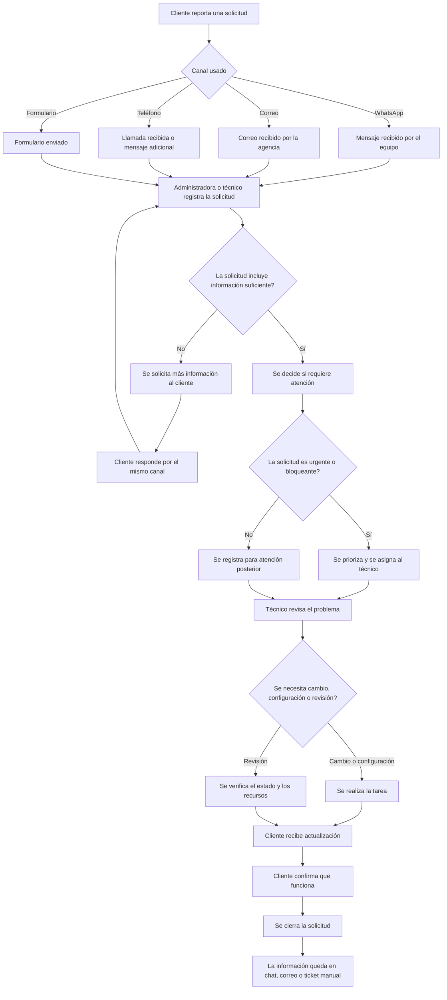
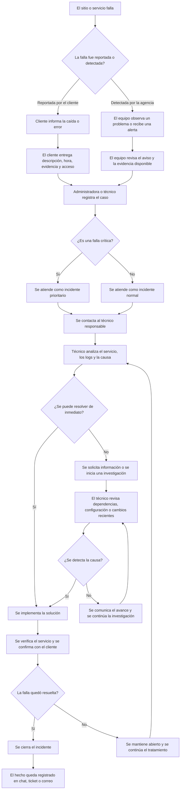
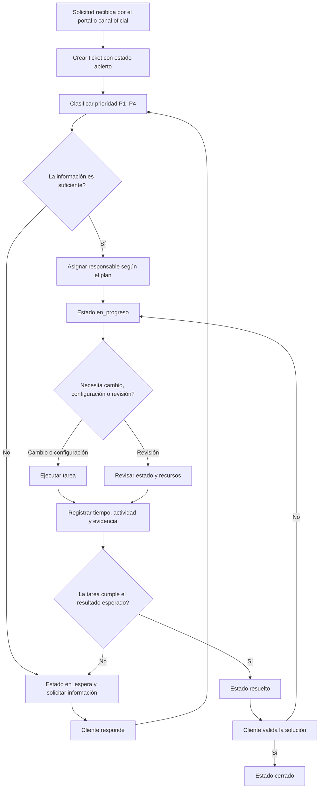
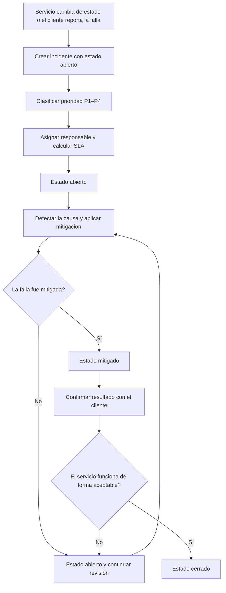
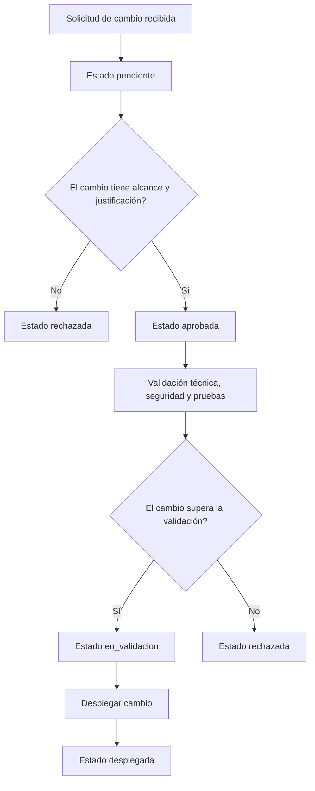

# Proceso AS-IS · Modelo de servicio

## Alcance

Este documento describe el estado actual de la operación de soporte de **Soluciones Digitales Popayán**, observado en las entrevistas ficticias. El proceso AS-IS representa cómo se reciben, gestionan y resuelven actualmente:

- una **solicitud de mantenimiento o cambio**, y
- una **falla o incidente**.

El objetivo es identificar los puntos donde una solicitud puede perderse, retrasarse, duplicarse o no tener una respuesta clara.

## Actores del proceso

| Actor | Responsabilidad en el AS-IS |
|---|---|
| Cliente PyME | Describe el problema, aporta evidencia y valida la solución. |
| Administradora de la agencia | Recibe la solicitud, coordina al equipo y decide la prioridad. |
| Técnico de soporte | Resuelve la solicitud o incidente y registra la actividad. |
| Cliente o agente externo | Puede recibir y retransmitir un mensaje cuando la agencia no tiene el registro centralizado. |

## 1. Proceso AS-IS de solicitud

Una solicitud puede representar un cambio, una configuración, una actualización o una consulta. Actualmente no existe un único canal con seguimiento automático.

### Descripción de las etapas

1. **Reporte inicial**
   - El cliente puede contactar a la agencia por WhatsApp, correo, teléfono o formulario.
   - Cada canal puede generar un registro distinto.

2. **Registro manual**
   - La administradora o el técnico registra la solicitud sin una plantilla obligatoria.
   - No siempre hay un identificador común ni una fecha única de creación.

3. **Validación de información**
   - El equipo solicita detalles cuando la petición está incompleta.
   - El cliente responde por el mismo canal, lo que puede dispersar la conversación.

4. **Priorización**
   - La prioridad depende de la percepción del equipo, del impacto económico y de la disponibilidad de recursos.
   - No existe una regla formal única para decidir el tratamiento.

5. **Atención técnica**
   - El técnico trabaja la solicitud y puede necesitar acceso, configuración o revisión del sitio.
   - La actividad puede estar documentada solo en conversaciones o correos.

6. **Confirmación del cliente**
   - El cliente prueba la solución y confirma si funciona.
   - La confirmación puede hacerse por llamada, chat o mensaje, sin registrar el resultado en el mismo ticket.

7. **Cierre**
   - La solicitud se cierra cuando el cliente confirma la solución.
   - El historial puede quedar fragmentado en varios canales.

### Problemas observados

- Una solicitud puede llegar por varios canales y generar registros duplicados.
- El equipo no puede saber siempre qué ha sido atendido y qué falta por revisar.
- La prioridad se decide de forma manual y puede variar entre técnicos.
- El cliente puede no saber qué estado tiene su solicitud.
- La relación entre la solicitud, las horas trabajadas y el plan contratado no está registrada de forma centralizada.

## 2. Proceso AS-IS de falla

Una falla puede ser conocida por el cliente o detectada de forma indirecta. Actualmente, la agencia depende en gran medida de la comunicación del cliente, del soporte o de la revisión manual.

### Descripción de las etapas

1. **Detección de la falla**
   - El cliente identifica que el servicio no funciona.
   - La agencia puede detectar la falla mediante una revisión manual o una alerta, aunque ese mecanismo no está integrado con el proceso actual.

2. **Recepción del reporte**
   - La información llega por WhatsApp, correo, teléfono o llamada.
   - El equipo debe pedir información adicional cuando el reporte no es claro.

3. **Registro del incidente**
   - El técnico o la administradora registra el caso.
   - No siempre existe un formato uniforme ni una clasificación automática.

4. **Evaluación de urgencia**
   - El equipo decide si la falla afecta ventas, disponibilidad o datos.
   - La definición puede depender de la experiencia de quien recibe el caso.

5. **Investigación técnica**
   - El técnico revisa logs, configuración, integraciones y cambios recientes.
   - El trabajo puede estar distribuido entre varias conversaciones y canales.

6. **Resolución**
   - La solución puede ser inmediata o requerir investigación adicional.
   - El progreso depende de la capacidad del técnico y de la disponibilidad de la evidencia.

7. **Verificación y cierre**
   - Se confirma con el cliente que el servicio funciona.
   - El incidente se cierra cuando la causa se ha tratado y el resultado fue validado.

### Problemas observados

- La caída puede no ser detectada inmediatamente por la agencia.
- La información del incidente puede quedar separada de la información técnica.
- No existe una clasificación obligatoria de severidad antes de atender.
- No siempre se informa al cliente cuándo comenzó, qué se está haciendo y cuándo finalizará.
- Las fallas fuera de horario dependen de la disponibilidad de la persona responsable.
- El cierre puede ser lento cuando la solución no se verifica con el cliente.

## 3. Diferencias entre los dos procesos

| Aspecto | Solicitud de cambio o mantenimiento | Falla o incidente |
|---|---|---|
| Motivo | Necesidad del cliente, ajuste o revisión. | Servicio disponible parcialmente o completamente afectado. |
| Inicio | Solicitud enviada por el cliente. | Fallo observado por el cliente o por la agencia. |
| Registro | Puede quedar en varios canales. | Puede quedar en varios canales y sin clasificación. |
| Priorización | Basada en impacto y disponibilidad. | Basada en impacto, urgencia y riesgo para el negocio. |
| Atención | Puede requerir configuración o desarrollo. | Requiere diagnóstico, recuperación y validación. |
| Confirmación | Cliente valida la tarea realizada. | Cliente confirma que el servicio funciona. |
| Cierre | Solicitud finalizada y documentada. | Incidente cerrado con evidencia de resolución. |

## 4. Hallazgos del proceso AS-IS

1. El proceso depende de personas, mensajes y registros manuales.
2. La prioridad se asigna después de recibir la información, sin una regla automatizada.
3. El cliente no tiene un portal común para ver el estado de una solicitud o una falla.
4. El equipo debe consultar varios canales para reconstruir la historia del caso.
5. Las respuestas fuera de horario no tienen una regla de atención definida.
6. La administración y la operación no cuentan con una vista única de los casos.

## 5. Proceso TO-BE de solicitud

El TO-BE centraliza toda solicitud en un único ticket. La fecha, el canal, la prioridad, las acciones y el tiempo se registran en un mismo registro, sin depender de conversaciones individuales.

### Estados canónicos de un ticket

| Estado | Significado | Transición posible |
|---|---|---|
| `abierto` | El caso fue creado y requiere revisión. | `en_progreso`, `en_espera` |
| `en_progreso` | Un técnico está realizando la tarea. | `en_espera`, `resuelto` |
| `en_espera` | Falta información, acceso, confirmación o una dependencia externa. | `en_progreso`, `cerrado` |
| `resuelto` | La tarea fue ejecutada y el resultado se encuentra registrado. | `cerrado` |
| `cerrado` | El cliente confirmó la solución o la solicitud fue cerrada por la administradora. | No tiene transición posterior. |

### Regla de cada transición

1. `abierto` se crea únicamente cuando existe un canal de origen, una descripción y una prioridad inicial.
2. `en_progreso` requiere responsable asignado y hora de inicio.
3. `en_espera` se utiliza cuando se necesita información, autorización, acceso o una dependencia externa.
4. `resuelto` requiere evidencia y confirmación del resultado.
5. `cerrado` exige que el cliente confirme la solución o que la administradora justifique el cierre.

## 6. Proceso TO-BE de falla

Una falla se convierte en incidente. El incidente usa la prioridad P1–P4, el reloj de SLA y un estado técnico propio.

### Estados canónicos de un incidente

| Estado | Significado | Transición posible |
|---|---|---|
| `abierto` | La falla fue detectada y aún no está mitigada. | `mitigado` |
| `mitigado` | La causa principal quedó controlada y se verificó una mejora parcial o total. | `cerrado` |
| `cerrado` | El servicio funciona de acuerdo con el criterio de aceptación y la evidencia quedó registrada. | No tiene transición posterior. |

### Regla de cada transición

1. `abierto` comienza cuando se registra la hora de inicio, la causa inicial y la prioridad.
2. `mitigado` requiere una acción concreta sobre la causa, un tiempo de mitigación y la evidencia de mejora.
3. `cerrado` requiere verificar la disponibilidad, revisar los efectos secundarios y obtener confirmación del cliente.
4. Un incidente no puede pasar directamente de `abierto` a `cerrado`.
5. Si falla la mitigación, el incidente permanece en `abierto` o vuelve a `abierto`.

### Escalamiento

Estas reglas aplican a cada objetivo de SLA que esté pendiente —respuesta y solución— en los
tickets e incidentes cubiertos por la política correspondiente. Cada objetivo se evalúa por separado:
por ejemplo, cumplir la respuesta no detiene el reloj de solución. El porcentaje se calcula sobre el
tiempo objetivo y el calendario que defina la política de SLA del caso; esta tabla no cambia horarios,
pausas ni tiempos objetivo, que se cierran en `seed/sla_policies.json`.

| Consumo del SLA | Nivel y destinatario | Acción requerida |
|---|---|---|
| **50 % · preventivo** | Aviso al técnico responsable; visible para la administradora de la agencia. | Revisar avance, confirmar que el caso sigue atendible dentro del tiempo restante y registrar la siguiente acción. Si hay un bloqueo o riesgo, informar a la administradora y dejar constancia de la causa. |
| **80 % · alto riesgo** | Escalamiento a la administradora de la agencia y aviso al técnico responsable. | La administradora revisa el bloqueo y la prioridad, coordina apoyo o reasignación si hace falta y acuerda con el técnico un plan para cumplir o mitigar. Informar al cliente el estado y la próxima actualización, sin prometer un plazo no confirmado. |
| **100 % · incumplido** | Alerta inmediata a la administradora y al técnico responsable. | Registrar el incumplimiento con hora real, objetivo afectado y tiempo transcurrido; informar al cliente con claridad sobre el estado y las acciones siguientes. Continuar la atención hasta cumplir el criterio de respuesta o solución: el aviso no cierra ni cambia el estado del caso. |

#### Reglas de registro y aplicación

- Los avisos se disparan al alcanzar por primera vez cada umbral mientras el objetivo siga pendiente.
- Registrar cada escalamiento en la línea de tiempo del caso con fecha y hora UTC, objetivo afectado
  (respuesta o solución), porcentaje alcanzado, responsable, destinatarios y acción tomada.
- Un cambio de responsable no reinicia el tiempo ni borra avisos previos. Si cambia la prioridad, se
  aplica el objetivo vigente según la política y se conserva la trazabilidad del tiempo ya transcurrido.
- Escalar no modifica automáticamente la prioridad ni los estados canónicos (`abierto`,
  `en_progreso`, `en_espera`, `mitigado` o `resuelto`). La administradora documenta cualquier
  decisión y el cliente recibe mensajes en lenguaje de negocio.

## 7. Estados del servicio

El servicio puede tener un estado independiente del ticket o del incidente:

| Estado | Significado |
|---|---|
| `operativo` | El servicio funciona y cumple los criterios básicos. |
| `degradado` | El servicio funciona parcialmente pero con pérdida de funcionalidad. |
| `caido` | El servicio no está disponible o responde con error grave. |

El estado del servicio debe actualizarse cuando cambia la disponibilidad, la calidad o la capacidad de atender solicitudes.

## 8. Proceso de cambio con estados canónicos

Una solicitud de cambio usa una ruta distinta de un ticket de soporte:

### Transiciones de una solicitud de cambio

- `pendiente` → `aprobada`: el cambio tiene alcance, responsable y justificación.
- `pendiente` → `rechazada`: falta información, alcance o autorización.
- `aprobada` → `en_validacion`: se inicia la revisión técnica, de seguridad y de pruebas.
- `en_validacion` → `desplegada`: el cambio cumple las validaciones y se publica.
- `en_validacion` → `rechazada`: el cambio no cumple las pruebas, seguridad o criterios definidos.

## 9. Diferencias principales entre AS-IS y TO-BE

| Aspecto | AS-IS | TO-BE |
|---|---|---|
| Registro | Chats, correos y tickets manuales. | Un único sistema de tickets. |
| Prioridad | Decisión manual. | Prioridad P1–P4 asignada por regla o responsable. |
| Responsable | Variable según la persona disponible. | Asignado por plan, disponibilidad y tipo de caso. |
| Estados | No siempre están definidos. | Estados canónicos y transición obligatoria. |
| Seguimiento | Fragmentado por canal. | Historia única del caso. |
| Información al cliente | Variable. | Estado visible y actualizado. |
| SLA | No se mide de forma uniforme. | Se mide desde la creación hasta el cierre o mitigación. |

## 10. Resultado esperado

El TO-BE permite que un caso recorra una ruta clara y medible:

- una solicitud de mantenimiento usa `abierto → en_progreso → en_espera → resuelto → cerrado`;
- una falla usa `abierto → mitigado → cerrado`;
- una solicitud de cambio usa `pendiente → aprobada → en_validacion → desplegada` o `rechazada`; y
- el servicio puede observarse como `operativo`, `degradado` o `caido`.

Este flujo elimina la dependencia de mensajes dispersos y permite medir el tiempo de respuesta, la duración, la carga del técnico y el cumplimiento del SLA.